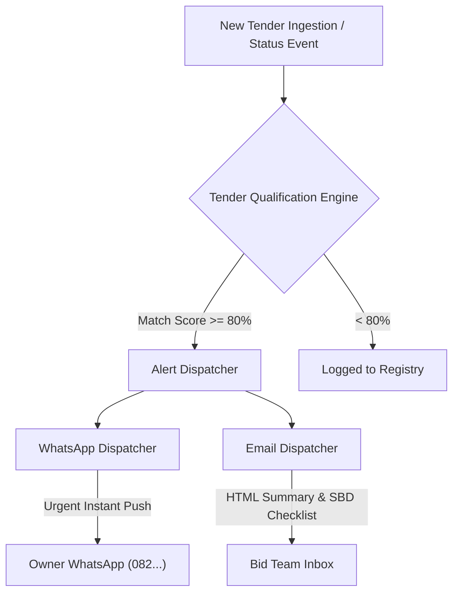

# South African Tender Tracker: Strategic Implementation Plan (Gauteng & Limpopo)

## Executive Summary
This implementation plan outlines the strategic and technical architecture for sourcing, qualifying, tracking, and winning public and private sector tenders in **South Africa**, with primary geographic specialization in **Gauteng** and **Limpopo**. The system focuses on **Software & Systems Development** and **Digital Marketing**, tailored to the legal and procedural requirements of the South African procurement environment (National Treasury Regulations, PPPFA, B-BBEE Codes of Good Practice, and Municipal Finance Management Act - MFMA).

---

## 1. South African Procurement Scope (Gauteng & Limpopo)

```
                                  ┌──────────────────────────────────────────────┐
                                  │      SOUTH AFRICAN TENDER INGESTION HUB      │
                                  └──────────────────────┬───────────────────────┘
                                                         │
                         ┌───────────────────────────────┴───────────────────────────────┐
                         ▼                                                               ▼
         ┌───────────────────────────────┐                               ┌───────────────────────────────┐
         │       GAUTENG PROVINCE        │                               │       LIMPOPO PROVINCE        │
         ├───────────────────────────────┤                               ├───────────────────────────────┤
         │ • GPG e-Tenders (e-Gov, DOH)  │                               │ • Limpopo Provincial Treasury │
         │ • Metros: Joburg, Tshwane,    │                               │   weekly Friday Tender Bulletin│
         │   Ekurhuleni                  │                               │ • Districts: Capricorn, Vhembe│
         │ • Entities: Gautrain, JRA,    │                               │   Mopani, Waterberg, Sekhukh. │
         │   Gauteng Tourism Authority   │                               │ • Local: Polokwane Mun.       │
         │ • Corporate: Sandton, Midrand │                               │ • Entities: LEDA, LTA, GAAL   │
         │   (Telcos, Banks, Discovery)  │                               │ • Mining: Anglo, Exxaro, De   │
         │                               │                               │   Beers (Mokopane, Musina)    │
         └───────────────────────────────┘                               └───────────────────────────────┘
```

### 1.1 Target Sourcing Portals

| Tier | Portal / Entity | Province / Scope | Categories Covered | Ingestion Method |
| :--- | :--- | :--- | :--- | :--- |
| **Tier 1 (National)** | **National Treasury e-Tender Portal** (`etenders.gov.za`) | National / All Provinces | Software, Systems, Digital Marketing | Scraper API / JSON Feed |
| **Tier 1 (Transversal IT)** | **State Information Technology Agency (SITA)** (`sita.co.za`) | Transversal Public ICT | Enterprise Software, Cloud, Cyber | Automated Scraper |
| **Tier 1 (Gov Comms)** | **GCIS Tender Bulletin** (`gcis.gov.za`) | National & Provincial | Digital Marketing, Media Buying, PR | RSS / Web Scraper |
| **Tier 2 (Gauteng)** | **Gauteng Provincial Treasury (GPG)** (`gauteng.gov.za`) | Gauteng | e-Gov, Cloud, Digital Tourism | Scraper |
| **Tier 2 (Gauteng Metros)** | City of Joburg, City of Tshwane, Ekurhuleni | Gauteng Municipalities | Smart City, Billing Apps, Municipal PR | Scraper / Portal Watcher |
| **Tier 2 (Limpopo)** | **Limpopo Provincial Treasury** (`limtreasury.gov.za`) | Limpopo | Health IT, Education Systems, LEDA | Weekly Friday Bulletin PDF/HTML Parser |
| **Tier 2 (Limpopo Mun.)** | Polokwane, Capricorn, Vhembe Municipalities | Limpopo Districts | Web Portals, Wi-Fi Systems, Campaigns | Portal Watcher |
| **Tier 3 (Private SA)** | SAP Ariba SA & Coupa SA (Vodacom, Standard Bank, Anglo American) | Gauteng & Limpopo | Headless Web/App, IoT Telemetry, CRO | Supplier Network Integration / Lead Capture |

---

## 2. South African Statutory Compliance Matrix

In South Africa, tender bids are frequently disqualified at the **Functionality / Mandatory Compliance stage** before financial envelopes are even opened. The tracker enforces a strict pre-qualification gate:

```
┌────────────────────────────────────────────────────────────────────────────────────────┐
│                        SOUTH AFRICAN MANDATORY STATUTORY CHECKLIST                     │
├────────────────────────────────────────────────────┬───────────────────────────────────┤
│ Requirement                                        │ Verification Standard             │
├────────────────────────────────────────────────────┼───────────────────────────────────┤
│ 1. SARS Tax Compliance Status (TCS PIN)            │ Active, compliant PIN verified    │
│ 2. Central Supplier Database (CSD) Master Report   │ Active MAAA number, verified bank │
│ 3. B-BBEE Level Contributor Status                 │ SANAS Accredited Cert or Affidavit│
│ 4. SBD 4: Declaration of Interest                  │ Signed declaration by all directors│
│ 5. SBD 6.1: Preference Points Claim Form           │ 80/20 or 90/10 point system claim │
│ 6. CIPC Registration Documents (CoR14.3)           │ Certified within 3 months         │
│ 7. Certified ID Copies of All Directors            │ Certified within 3 months         │
│ 8. Compulsory Briefing Session Attendance Log      │ Signed register / MS Teams report │
│ 9. Audited Annual Financial Statements (AFS)       │ Past 3 consecutive financial years│
│ 10. COIDA Letter of Good Standing                  │ Active with Compensation Fund     │
│ 11. Two-Envelope Protocol Check                    │ Technical functionality separated │
│                                                    │ from pricing/financial schedule   │
└────────────────────────────────────────────────────┴───────────────────────────────────┘
```

---

## 3. Alerts Architecture: WhatsApp & Email System



### 3.1 WhatsApp Notification Rules:
- **Instant High-Match Alert**: Dispatched immediately when a tender matching Software/Systems or Digital Marketing in Gauteng or Limpopo exceeds an 80% relevance score.
- **Compulsory Briefing Countdown (< 24 Hours)**: In SA, missing a compulsory briefing session (e.g. MS Teams meeting or in-person in Polokwane/Joburg) results in **immediate statutory disqualification**. WhatsApp alerts fire 24h and 4h prior.
- **Submission Deadline (< 48 Hours)**: Critical countdown to ensure physical tender box drops or online portal uploads are not missed.

### 3.2 Gateway Options for WhatsApp:
1. **CallMeBot Webhook (Recommended for Instant Personal Setup)**:
   - Free, zero-setup HTTP GET gateway that sends WhatsApp messages directly to your personal phone number via a simple API call.
2. **Twilio WhatsApp Business API (Recommended for Enterprise/Team)**:
   - Production-grade, highly reliable gateway supporting group messages and automated interactive replies.
3. **Meta WhatsApp Cloud API**:
   - Direct connection via Meta Business Manager with first 1,000 monthly conversations free.

---

## 4. "What Is the Best Option?" Strategy Analysis

### 4.1 Best Option for Ingestion & Sourcing
> **The Best Option:** A **Scheduled Hybrid Ingestion Pipeline**.
- **Automated Web Scraper for National Treasury e-Tenders (`etenders.gov.za`)**: Because National Treasury mandates that all government entities (National, Gauteng Provincial Government, Limpopo Provincial Government, and all Municipalities) advertise tenders on e-Tenders.
- **Dedicated Parser for Limpopo Treasury Bulletin**: Limpopo publishes a weekly tender bulletin every Friday afternoon containing district and municipal notices.
- **Manual 1-Click Import for Enterprise RFPs**: Direct corporate RFPs from mining houses (Anglo American Mokopane) and financial institutions (FNB/Vodacom) ingested via browser bookmarklet or direct paste.

### 4.2 Best Option for Alerting
> **The Best Option:** A **Dual WhatsApp + Email Strategy**.
- **WhatsApp for Urgent Action Alerts**: Briefing sessions and closing deadlines require immediate mobile attention.
- **Email for Daily Digests & Proposal Document Packs**: Full RFP specifications, scope of work, and SBD compliance checklists are best reviewed on desktop via structured HTML email.

### 4.3 Best Option for Tech Stack & Hosting
> **The Best Option:** **Self-Contained Python + SQLite Backend with Local Webhook Alerting**.
- Zero external package dependencies, runs instantly on macOS, stores data persistently in local SQLite, and costs **R 0/month** in infrastructure overhead.
